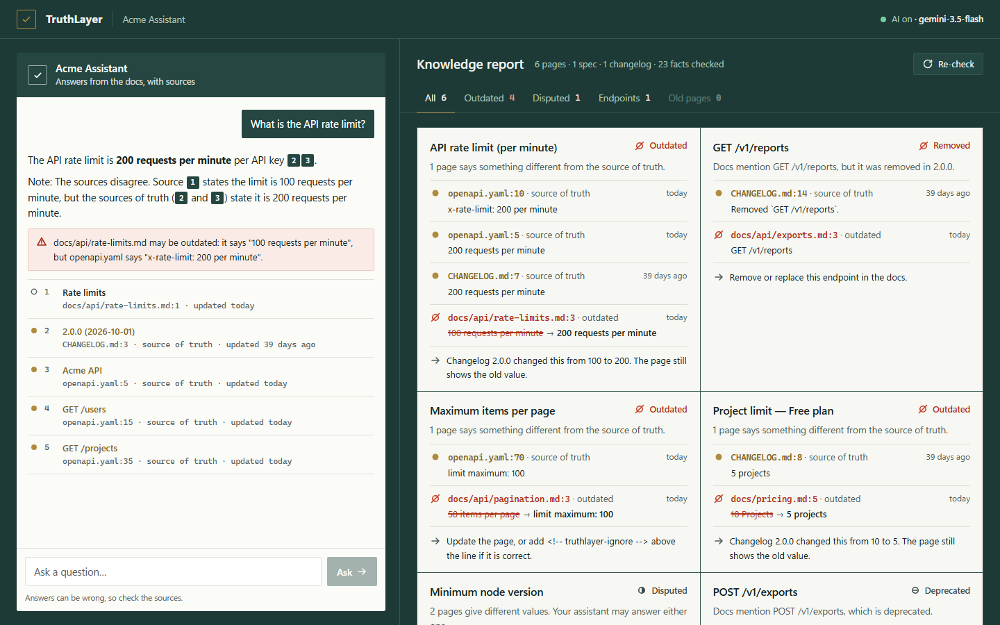
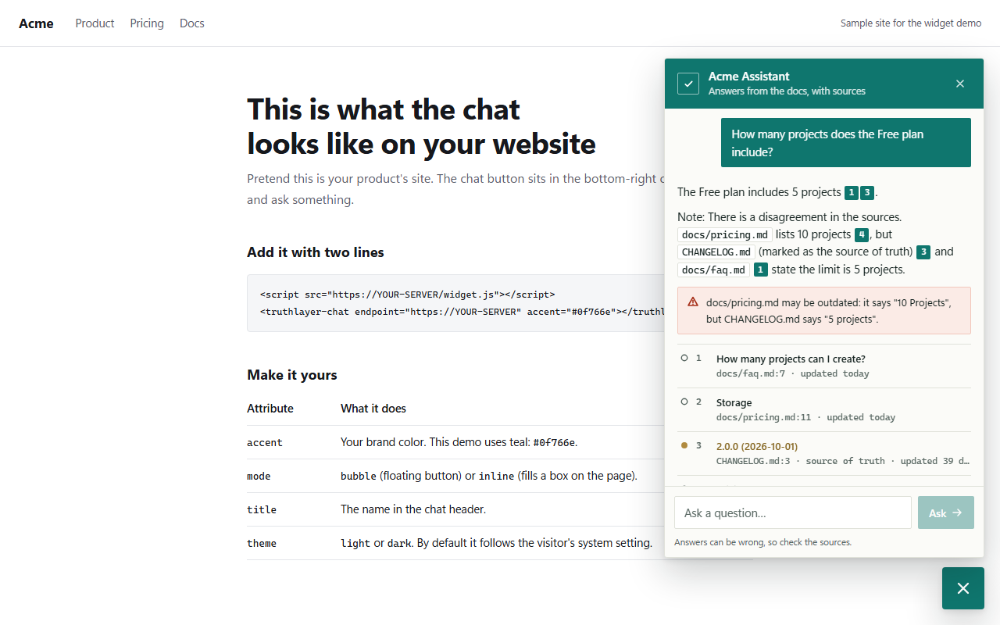

# TruthLayer

[](https://www.npmjs.com/package/truthlayer)
[](https://github.com/YashThokal777/truthlayer/actions/workflows/ci.yml)
[](LICENSE)


**Your docs changed. Does your AI know?**

TruthLayer is an open-source tool that keeps your product docs — and the AI assistant built on them — correct.

- 🔍 **Knowledge check:** finds facts in your docs that are **outdated** (they disagree with your OpenAPI spec or changelog) or **conflicting** (two pages say different things).
- 🤖 **Runs in CI:** a GitHub Action comments on every pull request that makes your docs wrong.
- 💬 **Cited chat assistant:** a local playground and an embeddable widget that answer from your docs, show sources and their age, and warn when a source may be outdated.
- 🏠 **Local-first and free:** no database, no server to rent. Bring your own AI key (Google Gemini has a free tier) or run fully local with Ollama.



```text
$ npx truthlayer check

TruthLayer · Acme Assistant
Scanned 6 pages, 1 OpenAPI spec, 1 changelog · 23 facts

  ✖ 4 outdated   ⚠ 1 conflict   ⚠ 1 endpoint warning   ℹ 0 old pages

✖ OUTDATED  API rate limit (per minute)
  1 page says something different from the source of truth.
    ✓ source of truth openapi.yaml:10            x-rate-limit: 200 per minute
    ✓ source of truth CHANGELOG.md:7             200 requests per minute
    ✗ outdated        docs/api/rate-limits.md:3  100 requests per minute
  → Changelog 2.0.0 changed this from 100 to 200. The page still shows the old value.

⚠ CONFLICT  Minimum node version
  2 pages give different values. Your assistant may answer either one.
    • says            docs/faq.md:5              Node.js 20 or later (newest)
    • says            docs/getting-started.md:7  Node.js 18 or later
```

## Why

Most "chat with your docs" tools copy your docs into an AI and hope they are correct. But docs go out of date: you raise a rate limit, change a price, remove an endpoint — and three pages still show the old value. Your assistant then gives wrong answers with confidence.

TruthLayer treats your **OpenAPI spec** and **changelog** as the source of truth and checks your docs against them on every change.

## Quick start

Requires Node.js 20.12 or newer.

```bash
npx truthlayer init      # creates truthlayer.yml (finds your docs, OpenAPI file and changelog)
npx truthlayer check     # find outdated and conflicting facts
npx truthlayer dev       # open the chat playground at http://127.0.0.1:4141
```

Try it on the example in this repo:

```bash
git clone https://github.com/YashThokal777/truthlayer && cd truthlayer && npm install
node src/cli.js check --cwd examples/acme-docs
node src/cli.js dev --cwd examples/acme-docs
```

## Configuration

`truthlayer.yml` lives in your repo, next to your docs ("assistant as code"):

```yaml
name: Acme Assistant

sources:
  - type: markdown        # .md / .mdx files (a folder or one file)
    path: ./docs
  - type: openapi         # OpenAPI 3 or Swagger 2, YAML or JSON — a source of truth
    path: ./openapi.yaml
  - type: changelog       # "Keep a Changelog" style — a source of truth
    path: ./CHANGELOG.md

check:
  stale_after_days: 180   # pages older than this are listed as "old" (info only)
  fail_on: never          # never | error | warning
  ignore_paths:           # globs, relative to this file
    - docs/legacy/**

assistant:
  provider: gemini        # gemini | groq | ollama | custom
  # model: gemini-3.5-flash          # optional: override the provider's default model
  # fallback_models: [gemini-3.1-flash-lite]   # tried when the main model is slow, busy or missing
  # timeout_seconds: 30
  top_k: 5                # how many doc sections to send to the AI
  suggestions:
    - What is the API rate limit?
```

| `provider` | Default model | Key (in `.env`) |
|---|---|---|
| `gemini` (default) | `gemini-3.5-flash`, falls back to `gemini-3.1-flash-lite` | `GEMINI_API_KEY` (or `GOOGLE_API_KEY`) |
| `groq` | `openai/gpt-oss-20b` | `GROQ_API_KEY` |
| `ollama` | `llama3.2` | none — runs on your computer |
| `custom` | set `model` | set `base_url` and `api_key_env` — any OpenAI-compatible API |

Any source can be marked as a source of truth with `truth: true` (or not, with `truth: false`).

## What TruthLayer checks

TruthLayer only checks facts that a program can check **reliably**. It does not ask an AI "do these two pages contradict each other?" — research shows that gives too many false alarms.

| Fact | Example sentence |
|---|---|
| Rate limits | "Each API key can make 100 requests per minute." |
| Prices | "The Pro plan costs $39 per month." |
| Plan limits | "The Free plan includes up to 5 projects." / pricing tables |
| Storage and file sizes | "10 GB of storage", "The maximum file size is 25 MB." |
| Pagination | "up to 50 items per page" vs. the `maximum` of a `limit` parameter |
| Timeouts and retention | "Requests time out after 30 seconds.", "Logs are kept for 30 days." |
| Required versions | "Requires Node.js 18 or later." |
| Latest version | "The latest version is 2.0." vs. the newest changelog entry |
| Endpoints | docs mention an endpoint that was removed, is deprecated, or is not in the spec |

Facts are compared only when they mean the same thing: same kind, same plan (Free / Pro / …), same endpoint, and same docs version.

**Finding types**

- **Outdated** — a page disagrees with your OpenAPI spec or the newest changelog entry.
- **Conflict** (warning) — two pages disagree and there is no source of truth to decide. Values inside one page (like a table of tiers) are not compared with each other.
- **Removed / deprecated / unknown endpoint** — a page mentions an endpoint that is gone, deprecated, or missing from the spec. "Unknown" is only reported for paths that share a first segment with the spec, so links to other services are skipped.
- **Old page** — a page has not changed for `stale_after_days` (uses git history).

### Avoiding false alarms

- Put `<!-- truthlayer-ignore -->` on the line above a sentence that is correct on purpose.
- Put `<!-- truthlayer-ignore-file -->` anywhere in a file to skip its facts.
- Docs in versioned folders (`docs/v1/…`, `docs/2.x/…`) are only compared with the same version.
- Facts that name a plan are only compared with facts for the same plan.
- Code blocks are ignored.
- The default `fail_on: never` means TruthLayer reports problems but never blocks a merge until you trust it.

## GitHub Action

Add `.github/workflows/truthlayer.yml` (or run `npx truthlayer init --github-action`):

```yaml
name: TruthLayer
on:
  pull_request:
permissions:
  contents: read
  pull-requests: write
jobs:
  knowledge-check:
    runs-on: ubuntu-latest
    steps:
      - uses: actions/checkout@v4
        with:
          fetch-depth: 0          # needed for git dates and the base-branch diff
      - uses: YashThokal777/truthlayer@main
        with:
          strict: 'false'         # 'true' fails the PR when errors are found
```

On each pull request, TruthLayer only reports findings that involve files changed in that PR, and posts (or updates) one comment:

> ### 🔴 Outdated: API rate limit (per minute)
> | | Where | Says |
> |---|---|---|
> | ✅ Source of truth | `openapi.yaml:10` | x-rate-limit: 200 per minute |
> | ❌ Outdated | `docs/api/rate-limits.md:3` | 100 requests per minute |
>
> 💡 Changelog 2.0.0 changed this from 100 to 200. The page still shows the old value.

You can also run it in any CI: `npx truthlayer check --base origin/main --strict`.

## Chat playground and widget

```bash
npx truthlayer dev
```

- `http://127.0.0.1:4141` — chat on the left, knowledge report on the right.
- `http://127.0.0.1:4141/embed` — the floating widget on a sample website.

Every answer cites its sources ([1], [2]) and shows when each source was last updated. If a source has a known problem, the answer shows a warning.



**AI provider.** Put your key in a `.env` file next to `truthlayer.yml`:

```bash
GEMINI_API_KEY=your-key-here
```

Get a free Gemini key at [Google AI Studio](https://aistudio.google.com/apikey). The free tier needs no credit card, but it has low per-minute limits, and Google may use free-tier prompts to improve its products — use Ollama (`provider: ollama`) for private docs. With no key, the assistant still works in **search-only mode** and shows the matching parts of your docs.

**Embed the widget** on your site (the server must be reachable from your users' browsers):

```html
<script src="https://your-server/widget.js"></script>
<truthlayer-chat endpoint="https://your-server" accent="#4f46e5"></truthlayer-chat>
```

Attributes: `endpoint`, `mode="bubble|inline"`, `title`, `accent`, `theme="light|dark"`.

> ⚠️ `truthlayer dev` is a local development server. If you host it publicly, put it behind a rate limit — every question uses your AI key.

## Commands

| Command | What it does |
|---|---|
| `truthlayer init [--github-action] [--force]` | Create `truthlayer.yml` (and a workflow) |
| `truthlayer check [--base <ref>] [--format terminal\|markdown\|json] [--output <file>] [--strict]` | Run the knowledge check |
| `truthlayer dev [--port 4141] [--host 127.0.0.1]` | Chat playground and knowledge report |
| `truthlayer ask "question"` | Ask a question in the terminal |
| `truthlayer facts` | List every fact found (useful for debugging) |

All commands accept `--cwd <dir>` and `--config <file>`.

## Use it with coding agents

`skills/claude-code/truthlayer/SKILL.md` is a skill for Claude Code, and `skills/AGENTS.md` is a snippet for Codex and other agents. They tell the agent to run `truthlayer check` after it changes docs, the API spec or the changelog, and to fix the pages it made outdated.

## Limits (honest list)

- Facts are found with patterns, not AI. Sentences written in unusual ways can be missed. Run `truthlayer facts` to see what was found.
- Best for SaaS and API product docs (limits, prices, plans, endpoints). Reference docs without such facts will show few or no findings.
- Search uses keywords (BM25), not embeddings, so it works offline with no downloads. Questions that use very different words from the docs may find weaker sources.
- Website crawling is not supported yet; point TruthLayer at your Markdown source files.

## Roadmap

- [ ] Website source (crawl a docs site)
- [ ] Optional local embeddings for better search
- [ ] Facts from OpenAPI response schemas and enums
- [ ] Yes/no feature facts ("Exports support CSV only")
- [ ] Hosted widget backend example (Cloudflare Worker, free tier)

## Contributing

```bash
npm install
npm test
```

Bug reports with a sentence TruthLayer missed (or flagged wrongly) are very welcome.

## License

MIT
